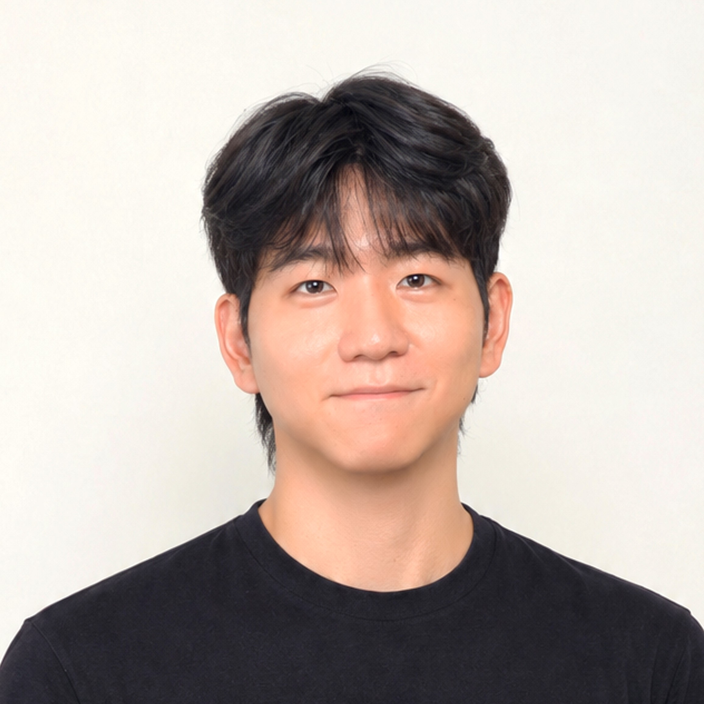

Kim Jeonghyeon &middot; 김정현

  

    
  

  

    I'm an M.S. student in Mechanical Engineering at <a href="https://www.korea.ac.kr/">Korea University</a>, where I work in the Human-Machine Systems Lab under Prof. Shinsuk Park. My research asks one question: when a robot's model is wrong, which errors actually matter for its task? I study it on hardware, with a humanoid that holds a push in place before deciding to step (<a href="/projects/humanoid-push-recovery/">Unitree G1</a>) and a manipulator that keeps a drawing in place on a tilted surface it cannot see (<a href="/projects/ipcr-manipulation/">Dobot CR3A</a>). I believe good control doesn't come from building a more complex model, but from designing a model at the level that fits the purpose. I received my B.S. in Mechanical Engineering from <a href="https://www.korea.ac.kr/">Korea University</a> in 2025.
  

  <a href="mailto:ahdtld54@korea.ac.kr">Email</a> /
  <a href="/assets/files/cv.pdf">CV</a> /
  <a href="https://github.com/Juunghyeon">GitHub</a> /
  <a href="https://www.linkedin.com/in/%EC%A0%95%ED%98%84-%EA%B9%80-b2a0b8263/">LinkedIn</a>

---

## Research Interests

- **Control-oriented dynamics modeling.** Deciding, from task performance and limited hardware data, which physical effects a controller must model explicitly and which it can treat as uncertainty
- **Physical models and learning together.** Using learning where physics alone falls short, and reading what the learned correction says about the model
- **Where modeling is hardest.** Contact-rich manipulation, legged and humanoid robots, and new robot structures with no standard model
- **Hardware–control co-design.** Letting what limits a task show where a change in the body could help

---

## Leadership

**Quadruped Robot Obstacle Avoidance — Creative Challenger Program**
Mar. 2024 – Jan. 2025

*Team Leader · RoboStride · Korea University*

Led a four-person team building an ORB-SLAM and UV-disparity based obstacle-avoidance pipeline for a quadruped robot. Won the President's Award; the work was later presented at the KSPE 2025 Spring Conference. [Project page →](/projects/ccp-quadruped/)

**Ladder-Crossing Robot**
Mar. 2023 – Sep. 2023

*Team Leader · 5-person team · Korea University*

Led the mechanical design and control of a robot that climbs a horizontal ladder by gripping successive rungs and shifting its center of mass; the team built on my mechanism concept. The first design kept swinging from its grip and missing the next rung, which is where my research question started. [Project page →](/projects/ladder-crossing/)

**Solar Tracking Parasol**
Sep. 2023 – Nov. 2023

*Team Leader · Korea University*

Led the design of a parasol that senses sun position and actuates its canopy to track it. Won the Bronze Award at the Creative Comprehensive Design Competition and the Design Award at the Capstone Design Fair. [Project page →](/projects/solar-parasol/)

---

## Teaching Experience

**Teaching Assistant, Robotics**
Spring 2026

*Korea University*

**Teaching Assistant, Computer-Aided Design**
Fall 2025

*Korea University*

**Teaching Assistant, Dynamics** *(English-taught course)*
Summer 2025

*Korea University*

**Teaching Assistant, Kinematics of Mechanisms**
Spring 2025

*Korea University*

---

## Skills

**Hardware** — Unitree G1 &middot; Dobot CR3A &middot; EtherCAT-based arm (ENI/ESI configuration) &middot; mobile manipulator
**Robotics & Simulation** — ROS2 &middot; Pinocchio &middot; MuJoCo &middot; Isaac Sim / Isaac Lab &middot; Gazebo &middot; URDF / XACRO
**Programming** — Python &middot; C++ &middot; CMake &middot; MATLAB
**Learning & Control** — Model Predictive Control &middot; CasADi / CVXPY &middot; PyTorch &middot; Reinforcement Learning (PPO)
**Computer Vision** — OpenCV &middot; AprilTag
**Tools** — Linux (Ubuntu) &middot; Git / GitHub
