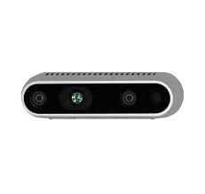
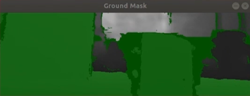
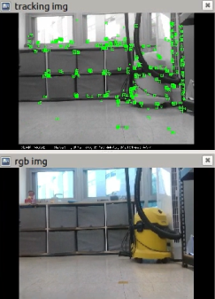
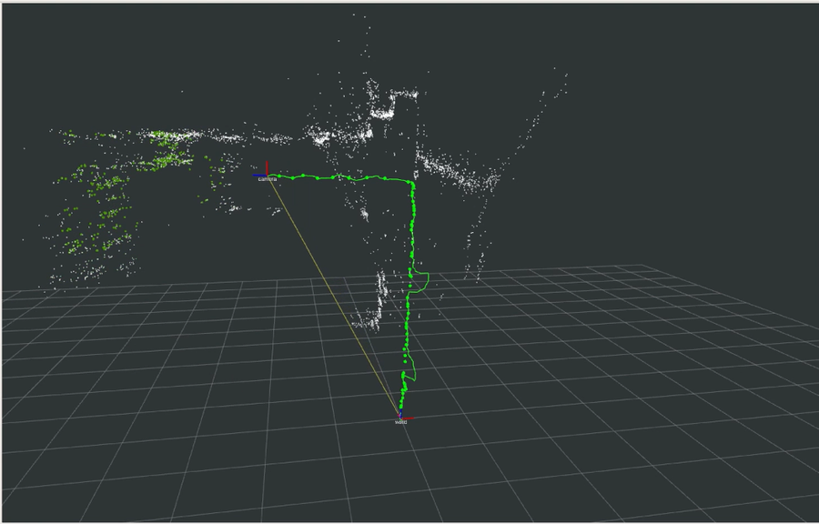
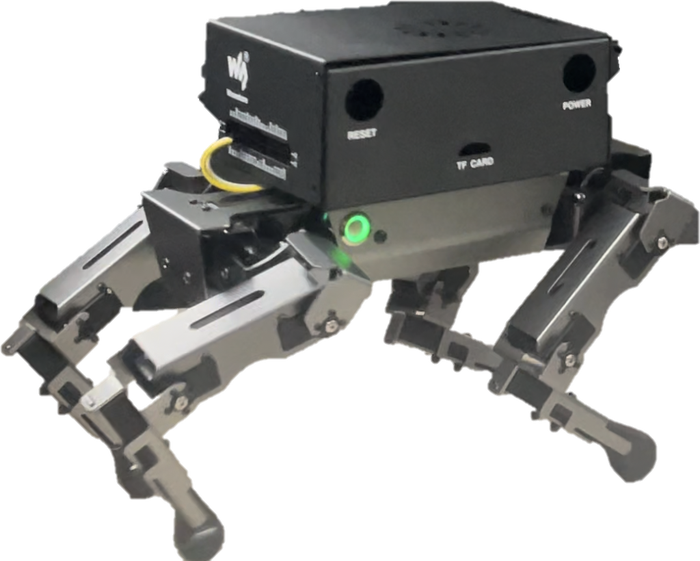
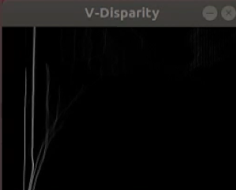
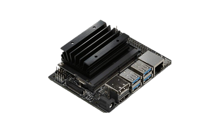
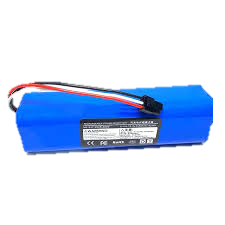
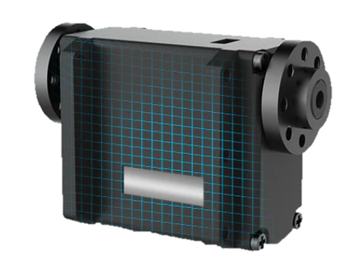

## Abstract

Built a monocular-camera obstacle-avoidance pipeline for the DOGZILLA quadruped, estimating scene depth with ORB-SLAM and segmenting obstacles from U/V-disparity maps — enabling real-time autonomous navigation in unstructured environments without a dedicated depth sensor (LiDAR or stereo). Led the four-person RoboStride team through Korea University's Creative Challenger Program.

  

    <strong>Jetson Nano</strong> 
    onboard
  

  

    
RGB-D / Realsense-ros →

    
← Control Topic / ROS

  

  

    <strong>Desktop</strong> 
    off-board 
    ORB-SLAM3 UV_disparity 
    ↓ 
    Control Topics
  

*Onboard, the Jetson Nano only relays RGB-D over Wi-Fi; all SLAM and disparity processing runs off-board on a desktop, which sends control topics back over ROS.*

## Method

- Estimated scene depth from a single RGB feed with monocular ORB-SLAM, extracting sparse 3D point clouds for obstacle localization
- Built U-disparity and V-disparity maps from the estimated depth to segment obstacles from the ground plane by disparity peaks
- Fed detections into the robot's navigation controller to trigger real-time avoidance maneuvers

  <figure style="margin:0; text-align:center;">
    
    <figcaption style="font-size:0.8em; opacity:0.7; margin-top:0.4em;">V-disparity map</figcaption>
  </figure>
  <figure style="margin:0; text-align:center;">
    
    <figcaption style="font-size:0.8em; opacity:0.7; margin-top:0.4em;">Ground mask (disparity + depth)</figcaption>
  </figure>

*The V-disparity map's dominant line marks the ground plane; deviations from it flag obstacles (green/gray regions in the mask).*

  <figure style="margin:0; text-align:center;">
    
    <figcaption style="font-size:0.8em; opacity:0.7; margin-top:0.4em;">Feature tracking (top) / RGB frame (bottom)</figcaption>
  </figure>
  <figure style="margin:0; text-align:center;">
    
    <figcaption style="font-size:0.8em; opacity:0.7; margin-top:0.4em;">3D point cloud and camera trajectory</figcaption>
  </figure>

*ORB feature points tracked across frames (left) build the 3D point cloud and camera trajectory (right) used for localization.*

## Results

Won the President's Award (1st Place) at Korea University's Creative Challenger Program, and later presented the work at the KSPE 2025 Spring Conference.

## Platform

  
  

    <figure style="margin:0;"><figcaption>RGB-D Camera Realsense D435</figcaption></figure>
    <figure style="margin:0;"><figcaption>On-board PC Jetson Nano, 4GB</figcaption></figure>
    <figure style="margin:0;"><figcaption>Li-Po Battery 8.4V, 18650mAh</figcaption></figure>
    <figure style="margin:0;"><figcaption>Servo Motor ×12 360°, 5.7kg·cm</figcaption></figure>
  

DOGZILLA quadruped · monocular RGB camera

## Skills

`C++` `Python` `ROS2` `ORB-SLAM` `OpenCV`
