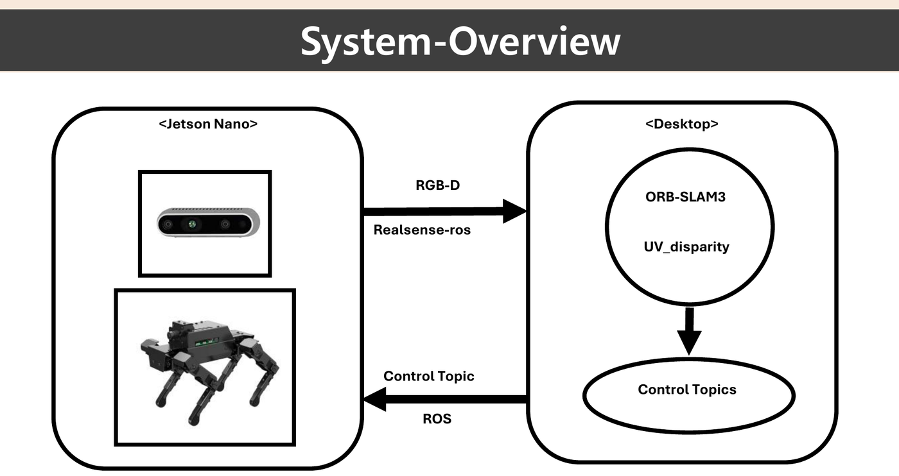
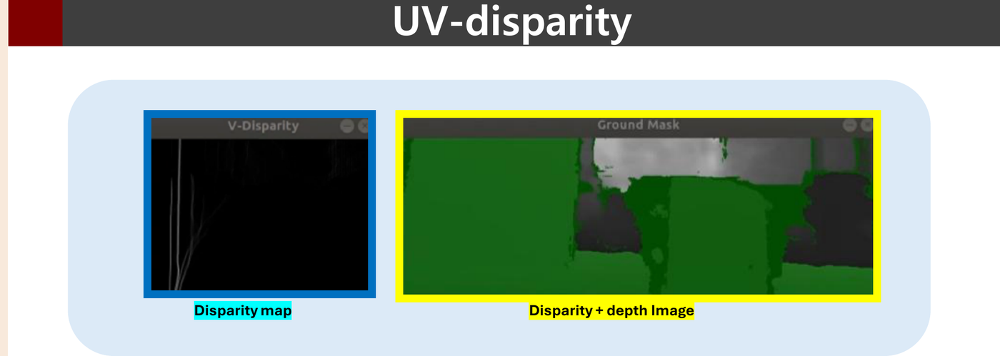
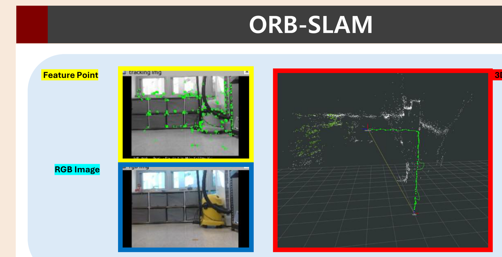
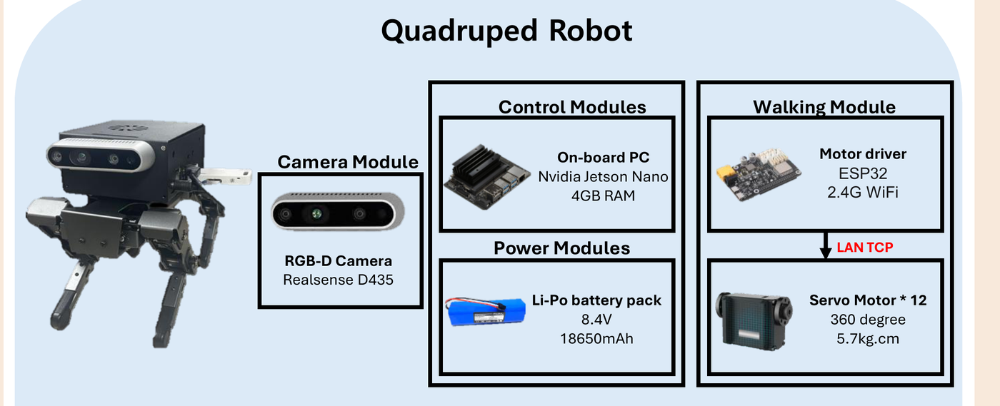

## Abstract

Built a monocular-camera obstacle-avoidance pipeline for the DOGZILLA quadruped, estimating scene depth with ORB-SLAM and segmenting obstacles from U/V-disparity maps — enabling real-time autonomous navigation in unstructured environments without a dedicated depth sensor (LiDAR or stereo). Led the four-person RoboStride team through Korea University's Creative Challenger Program.

*Onboard, the Jetson Nano only relays RGB-D over Wi-Fi; all SLAM and disparity processing runs off-board on a desktop, which sends control topics back over ROS.*

## Method

- Estimated scene depth from a single RGB feed with monocular ORB-SLAM, extracting sparse 3D point clouds for obstacle localization
- Built U-disparity and V-disparity maps from the estimated depth to segment obstacles from the ground plane by disparity peaks
- Fed detections into the robot's navigation controller to trigger real-time avoidance maneuvers

*The V-disparity map's dominant line marks the ground plane; deviations from it flag obstacles (green/gray regions in the mask).*

*ORB feature points tracked across frames (left) build the 3D point cloud and camera trajectory (right) used for localization.*

## Results

Won the President's Award (1st Place) at Korea University's Creative Challenger Program, and later presented the work at the KSPE 2025 Spring Conference.

## Platform

DOGZILLA quadruped · monocular RGB camera

## Skills

`C++` `Python` `ROS2` `ORB-SLAM` `OpenCV`
