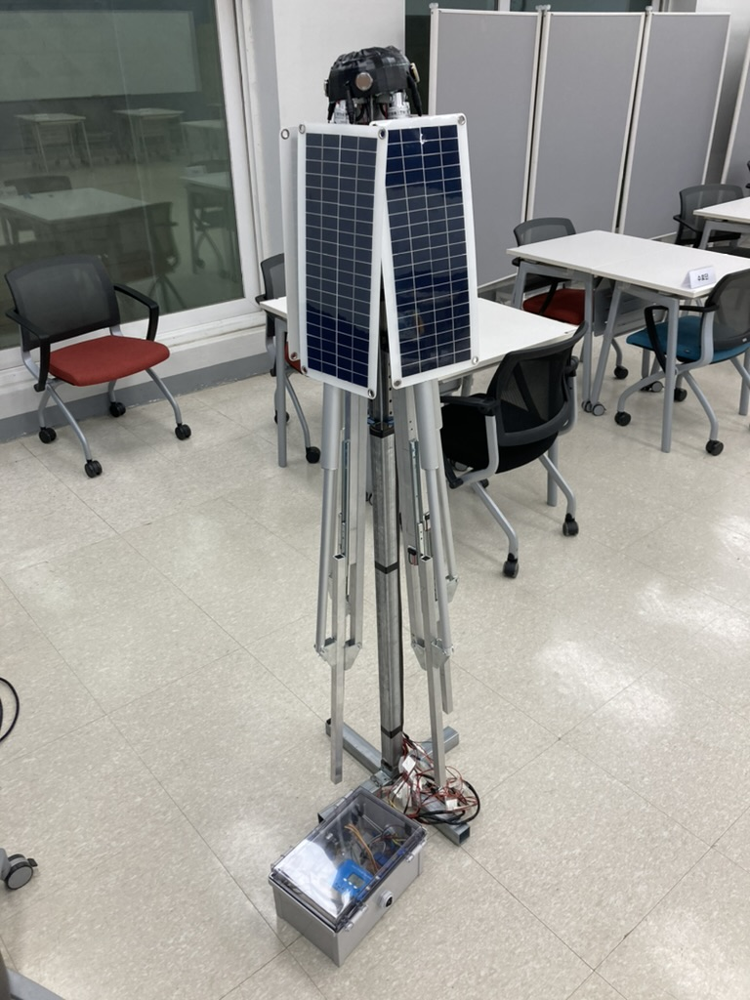

## Abstract

A parasol that automatically reorients its canopy to track the sun and maximize shade coverage, rather than staying fixed as the sun moves. Built on a tripod-mounted dual-panel frame with a light-sensor array for sun-position sensing and servo actuation for canopy orientation, controlled by an Arduino. Won the Bronze Award at the Creative Comprehensive Design Competition and the Design Award at Korea University's Capstone Design Fair.

## Method

- Sensed sun position with a light-sensor array rather than a fixed ephemeris model, so tracking adapts to real lighting conditions (cloud cover, obstructions)
- Computed the canopy orientation needed to maximize shade from the sensor readings
- Actuated the canopy angle with servo motors under Arduino control, mounted on a tripod base for standalone outdoor use

<svg viewBox="0 0 620 560" style="width:100%; max-width:560px; font-family:inherit;">
  <defs>
    <marker id="arrow" viewBox="0 0 10 10" refX="9" refY="5" markerWidth="7" markerHeight="7" orient="auto-start-reverse">
      <path d="M0,0 L10,5 L0,10 z" fill="#333"/>
    </marker>
  </defs>
  

  <!-- Start -->
  <rect class="node" x="90" y="15" width="140" height="46" rx="23"/>
  <text class="lbl" x="160" y="43">Start</text>
  <path class="edge" d="M160,61 L160,95"/>

  <!-- Close? diamond -->
  <polygon class="node" points="160,95 225,140 160,185 95,140"/>
  <text class="lbl" x="160" y="145">Close?</text>
  <text class="cond" x="110" y="205">False</text>
  <path class="edge" d="M160,185 L160,225"/>
  <text class="cond" x="330" y="130">True</text>
  <path class="edge" d="M225,140 L460,140 L460,225"/>

  <!-- Check Cds -->
  <rect class="node" x="90" y="225" width="140" height="46"/>
  <text class="lbl" x="160" y="253">Check Cds</text>
  <path class="edge" d="M160,271 L160,305"/>

  <!-- Check Quadrant -->
  <rect class="node" x="90" y="305" width="140" height="46"/>
  <text class="lbl" x="160" y="333">Check Quadrant</text>
  <path class="edge" d="M160,351 L160,385"/>

  <!-- pressSensor diamond -->
  <polygon class="node" points="160,385 240,430 160,475 80,430"/>
  <text class="lbl" x="160" y="422">if pressSensor</text>
  <text class="lbl" x="160" y="440">pressed?</text>
  <text class="cond" x="118" y="500">False</text>
  <path class="edge" d="M160,475 L160,505"/>

  <!-- Extend Actuator (left) -->
  <rect class="node" x="90" y="505" width="140" height="46"/>
  <text class="lbl" x="160" y="533">Extend Actuator</text>

  <!-- all pressSensor diamond -->
  <polygon class="node" points="460,385 550,430 460,475 370,430"/>
  <text class="lbl" x="460" y="422">if all pressSensor</text>
  <text class="lbl" x="460" y="440">pressed?</text>
  <text class="cond" x="500" y="500">True</text>
  <path class="edge" d="M460,475 L460,505"/>

  <!-- Extend Actuator (right) -->
  <rect class="node" x="390" y="505" width="140" height="46"/>
  <text class="lbl" x="460" y="533">Extend Actuator</text>
</svg>

*Closing logic: the canopy only extends once every photoresistor quadrant agrees the parasol is correctly oriented.*

<video controls preload="metadata" style="width:100%; border-radius:4px;">
  <source src="/assets/videos/solar-parasol/sim.mp4" type="video/mp4">
</video>
*Mechanism simulation: the four-panel canopy opening and closing before the physical build.*

## Results

Demonstrated continuous shade tracking through the day on the physical prototype, winning the Bronze Award at the Creative Comprehensive Design Competition and the Design Award at Korea University's Capstone Design Fair.

*The finished prototype: tripod-mounted dual-panel frame with the light-sensor array and servo-actuated canopy.*

## Skills

`Arduino` `AutoCAD` `C++`
